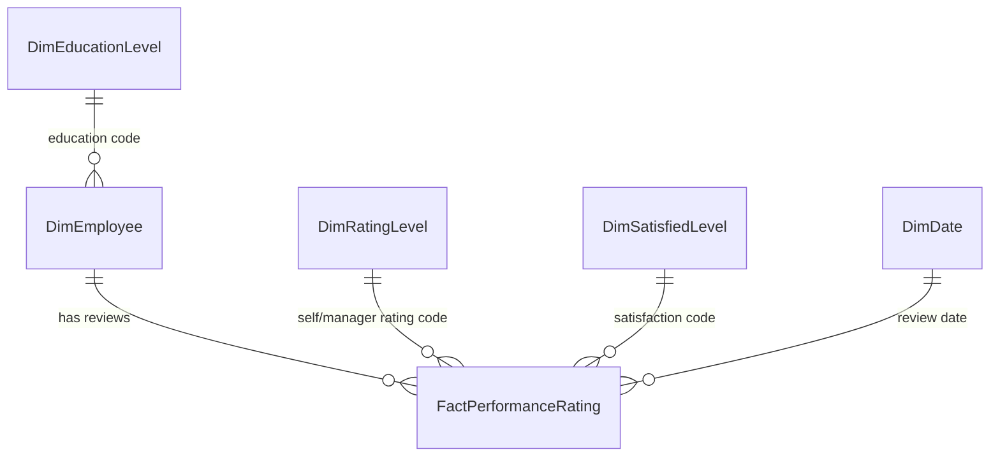

# HR Analytics Dashboard

A Power BI dashboard analyzing employee demographics, performance, and attrition, built on a star-schema data model with custom DAX measures and page-specific background visuals.


---

## Problem Statement

Employee attrition is one of the costliest and least visible risks an organization carries — replacing an employee typically costs half to twice their annual salary once recruiting, onboarding, and lost productivity are factored in. Most HR teams only see the problem after exit interviews have piled up.

This project consolidates employee demographic, performance, and attrition data into a single analytical model to answer four recurring questions:

1. **Who is leaving, and from where?** — attrition by department, role, and tenure
2. **What does the workforce look like?** — headcount by age, gender, education, marital status
3. **Is performance tracked consistently?** — self-rating vs. manager-rating trends over time
4. **What correlates with attrition risk?** — satisfaction, work-life balance, overtime, income, commute distance

> **Note on the data:** this build uses a well-known public synthetic HR dataset (1,470 employees, 16.1% attrition — matching IBM's widely used HR Attrition teaching dataset), restructured into a star schema for a Maven Analytics–style practice project. It is **not real company data**, and is intended as a portfolio/learning build, not a production deliverable.

---

## Dashboard Pages

| Page | What it shows |
|---|---|
| **Overview** | Headcount, salary, and attrition at a glance (KPI cards, department breakdown, treemap) |
| **Demographics** | Age, gender, education, and marital-status distribution across the workforce |
| **Performance Tracker** | Self-rating vs. manager-rating trends over time |
| **Attrition** | Attrition by department, role, and tenure; satisfaction comparison between stayers and leavers |

---

## Data Model

Star schema: one fact table surrounded by lookup dimensions.



| File | Role | Grain |
|---|---|---|
| `Employee.csv` | Dimension | One row per employee (1,470 rows) |
| `PerformanceRating.csv` | Fact | One row per performance review (6,709 rows) |
| `EducationLevel.csv` | Lookup dimension | Education code → label |
| `RatingLevel.csv` | Lookup dimension | Rating code → label |
| `SatisfiedLevel.csv` | Lookup dimension | Satisfaction code → label |
| `DimDate` | Calculated dimension | One row per calendar day (generated in DAX) |

---

## Repo Structure

```
.
├── HR_Analysis.pbix          # Power BI report (data model + 4-page dashboard)
├── data/
│   ├── Employee.csv
│   ├── PerformanceRating.csv
│   ├── EducationLevel.csv
│   ├── RatingLevel.csv
│   └── SatisfiedLevel.csv
├── assets/
│   └── backgrounds/          # Page background images (see below)
└── README.md
```

---

## Tools & Technologies

- **Power BI Desktop** — data modeling, DAX, report authoring
- **Power Query (M)** — data import and transformation
- **DAX** — calculated date table and measures
- **Source format** — CSV, Import storage mode

---

## Getting Started

1. Clone this repo
2. Open `HR_Analysis.pbix` in [Power BI Desktop](https://powerbi.microsoft.com/desktop/)
3. If prompted, re-point the data source to the `data/` folder on your machine (**Transform Data → Data Source Settings**)
4. Refresh the model

---

## Known Limitations

This build was reviewed for data-quality and modeling issues before being shared. Open items:

- [ ] **Trailing whitespace** in categorical fields (e.g. `"Marketing"` vs `"Marketing "`) causes duplicate categories in some visuals — needs a `Trim`/`Clean` step in Power Query
- [ ] **`DimDate` range** is derived only from `Employee[HireDate]`, but also slices `PerformanceRating[ReviewDate]` — works today but should be derived from the union of both date columns for safety on refresh
- [ ] **Unused custom visual** (Charticulator) is still registered in the file, adding unnecessary size, with no visual on any page actually using it
- [ ] No Row-Level Security implemented — would be required before using this pattern on real HR data

See the project documentation for full details and recommended fixes.

---

## License

This project uses a public, synthetic HR dataset for educational/portfolio purposes. No real employee data is included.
